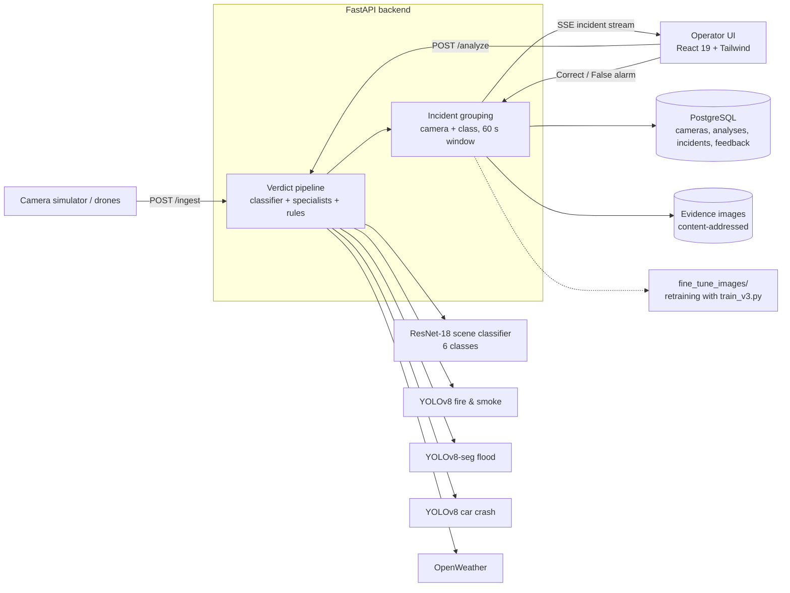

# RAID — Real-time Aerial Incident Detection

[](https://github.com/Nica880/natural-disaster-app/actions/workflows/ci.yml)


Cameras and drones stream frames; RAID decides whether something is wrong — wildfire, flood, car crash, cyclone or earthquake — and alerts an operator in real time with severity, affected area, recommended response units and on-scene weather. Operator corrections flow back into retraining.

Built end to end as a proof of concept for a client and as my Master's thesis: FastAPI backend, PyTorch / YOLOv8 models, React operator UI, PostgreSQL, Docker Compose.

## Highlights

- **98.3% correct verdicts** on a 120-frame disaster audit (up from 81.7%), with **zero wrong-type alerts**.
- **False alarms on benign scenes cut from 6/10 to 1/10** by adding a "Normal" class and calibrated arbitration rules.
- **Multi-model verdict pipeline:** a ResNet-18 scene classifier cross-checked by specialist YOLOv8 detectors for fire & smoke, flood and car crashes.
- **Live operator board** over Server-Sent Events: frames are grouped into incidents, with chime + desktop notification on new ones.
- **Human-in-the-loop retraining:** "Correct / False alarm" feedback is stored and exported as training data for the next run.
- **One command to run everything:** `docker compose up --build` starts the API, operator UI, camera simulator and PostgreSQL.

## Architecture




---

## Quick start

```bash
git clone https://github.com/Nica880/natural-disaster-app.git
cd natural-disaster-app

# 0. (optional) live weather on incidents — free OpenWeather key
cp .env.example .env       # then paste your key into OPENWEATHER_API_KEY

# 1. Backend
python3 -m pip install -r requirements.txt
uvicorn app.main:app --reload --port 8000

# 2. Frontend (new terminal)
cd frontend
npm install
npm run dev
```

Open http://localhost:5173 in the browser. The frontend talks to the backend on `http://127.0.0.1:8000`.

Health check: <http://127.0.0.1:8000/health> — shows which models loaded.
Interactive API docs: <http://127.0.0.1:8000/docs>.

---

## Run the full stack with Docker

Backend, operator UI, camera simulator, and PostgreSQL — one command:

```bash
docker compose up --build
```

The root `.env` (see `.env.example`) is picked up automatically — `OPENWEATHER_API_KEY` enables the weather panel; leaving it empty just disables that endpoint (503), everything else works.

| Service | URL |
| --- | --- |
| Operator UI (Monitor) | http://localhost:5173 |
| Camera simulator | http://localhost:5174 |
| Backend API / Swagger | http://localhost:8000/docs |
| PostgreSQL | `localhost:5432` (`raid` / `raid`) |

`docker compose down` stops it; add `-v` to also wipe the database + image volumes.

---

## Live monitoring pipeline

Besides the manual **Analyze** page, the app simulates a real deployment where cameras stream frames and the operator is alerted only when something is detected:

- **Camera simulator** (`camera_sim/`, port 5174) — simulated cameras POST frames to `/api/v1/ingest` on a timer.
- **Monitor** (operator home `/`) — live incident board over Server-Sent Events; new incidents trigger a chime + desktop notification. Frames from the same camera + disaster class are grouped into one **incident**, and dismissing one suppresses re-alerts for a cooldown window.
- **Incident detail** — click any incident for evidence frames, metrics (severity, affected area), recommended response units, location + map link, **live weather on scene** (OpenWeather + a disaster-aware risk note: wind matters for a wildfire, rain/cold for a flood), and the feedback control.
- **Feedback → retraining loop** — "Correct" records ground truth; "False alarm" opens a dropdown (*what is actually in the image?* — 5 disaster types + Normal). The correction is stored and the incident's original frame is exported to `fine_tune_images/<class>/`, which the training scripts merge automatically on the next run.
- **History** — a dropdown on Monitor lists closed incidents from the database.

**Persistence:** PostgreSQL is the system of record; the live board is an in-memory read model written through to the DB and rehydrated on restart (incidents survive a restart). Evidence images are content-addressed on a volume, referenced from the DB.

| Table | Holds |
| --- | --- |
| `cameras` | Auto-registered sources + heartbeat |
| `analyses` | Every inference (upload + camera frame) |
| `incidents` | Grouped detections shown to the operator |
| `feedback` | Operator ground-truth (precision metrics + retraining) |

Added endpoints: `POST /api/v1/analyze`, `POST /api/v1/ingest`, `GET /api/v1/incidents[/stream|/history|/{id}]`, `POST /api/v1/incidents/{id}/{dismiss,feedback}`, `GET /api/v1/images/{ref}`, `GET /api/v1/weather?lat&lon&disaster_type`.

---

## Detection accuracy

The verdict pipeline (scene classifier + specialist detectors + calibrated arbitration rules in [app/api/routes/analyze.py](app/api/routes/analyze.py)) is measured by two reproducible audits:

```bash
python model/audit_pipeline.py        # 120 ground-truth disaster frames (camera_sim/samples)
```

| Metric | v1 (5 epochs, no augmentation) | current (v3 + rules) |
| --- | --- | --- |
| Disaster audit (120 frames) | 98/120 (81.7%), 16 wrong-type verdicts | **118/120 (98.3%), 0 wrong-type** |
| Benign scenes → false incidents | 6/10 | **1/10** |
| Classifier test split | — | **99.0%** (6 classes, 1 096 images) |

The classifier is a ResNet-18 with **6 classes** — the 5 disasters plus **Normal** (no emergency), so a highway with traffic or a beach no longer has to be force-labelled as a disaster. Methodology, measurements and threshold rationale: [docs/antrenare_clasificator_v2.md](docs/antrenare_clasificator_v2.md), [docs/clasa_normal_scene_benigne.md](docs/clasa_normal_scene_benigne.md), [docs/sistem_feedback_reantrenare.md](docs/sistem_feedback_reantrenare.md).

---

## Prerequisites

| | Version | Notes |
| --- | --- | --- |
| Python | 3.9+ | macOS ships 3.9; the code works on 3.9 thanks to `eval_type_backport`, but 3.10+ is smoother. |
| Node.js | 18+ | Comes with `npm`. Tested with Node 20. |
| Disk space | ~2 GB | Models + node_modules. The full `Datasets/` folder (4.4 GB) is gitignored and not needed unless you re-train. |
| GPU | Optional | Mac MPS works for training; for fast retraining use a free [Google Colab](https://colab.research.google.com) T4 (notebooks under `notebooks/`). |

---

## Model weights

Some of the trained weight files are large and **gitignored** (`*.pt`, `*.pth`, `runs/`). The app starts even if any of them is missing — the affected endpoint will return `503 Service Unavailable` and the rest keeps working. Check `/health` to see which are loaded.

| Model | Path | Source | Size |
| --- | --- | --- | --- |
| Stock YOLOv8n weights | `yolov8n.pt`, `yolov8n-oiv7.pt`, `yolov8n-seg.pt` | Ultralytics (auto-downloaded on first run) | ~7 MB each |
| Scene classifier (ResNet-18, 6 classes incl. Normal) | `model/disaster_model.pth` | Trained from `model/train_v3.py` on the Roboflow Natural Disasters set + a benign "Normal" set (`model/train.py` is the legacy v1 recipe) | ~43 MB |
| Flood segmenter (legacy) | `runs/segment/flood_seg/weights/best.pt` | Trained from `model/train_flood_yolo.py` | ~6 MB |
| **Fire & smoke** | `model/fire.pt` | Trained via [notebooks/train_fire_yolo.ipynb](notebooks/train_fire_yolo.ipynb) on D-Fire | ~22 MB |
| **Flood (new)** | `model/flood.pt` | Trained via [notebooks/train_flood_yolo.ipynb](notebooks/train_flood_yolo.ipynb) on FloodNet 2021 | ~23 MB |
| **Car-crash** | `model/carcrash.pt` | Trained via [notebooks/train_carcrash_yolo.ipynb](notebooks/train_carcrash_yolo.ipynb) on Roboflow accident-detection-model | ~22 MB |

If you cloned the repo fresh, the bottom three need to be trained (see [Training](#training-models-google-colab) below) — the rest are either auto-downloaded by Ultralytics or already in `model/`.

---

## Project layout

```
.
├── app/                          FastAPI backend
│   ├── main.py                   App factory + lifespan
│   ├── config.py                 Settings (env-overridable paths/thresholds)
│   ├── logging.py
│   ├── api/
│   │   ├── deps.py               ModelRegistry + DI providers
│   │   └── routes/               health, classify, detect, analyze,
│   │                             monitor, weather, images, drone
│   ├── schemas/responses.py      Pydantic response models
│   └── services/                 One module per model
│       ├── classifier.py         ResNet-18
│       ├── detector.py           YOLOv8 · Open Images V7
│       ├── fire.py               YOLOv8 · D-Fire + severity + crews
│       ├── flood.py              YOLOv8-seg (class-name-agnostic)
│       └── carcrash.py           YOLOv8 · accident-detection + severity + crews
│
├── frontend/                     React 19 + Vite + Tailwind v4
│   └── src/
│       ├── main.jsx              Router root (BrowserRouter, 3 routes)
│       ├── App.jsx               Layout shell
│       ├── routes/               Home, Analyze, About
│       ├── components/
│       │   ├── layout/           Navbar, Footer
│       │   ├── ui/               Button, Card, Badge, Metric,
│       │   │                     ProgressBar, SeverityMeter, Alert
│       │   └── analyze/          ImageDropzone, ActionGroup, results/*
│       ├── hooks/useAnalysis.js  Per-key result/error/loading state
│       ├── lib/                  disasters.js, format.js
│       └── services/api.js       Single API client
│
├── notebooks/                    Colab training notebooks (T4-ready)
│   ├── train_fire_yolo.ipynb
│   ├── train_flood_yolo.ipynb
│   └── train_carcrash_yolo.ipynb
│
├── model/                        Training & inference scripts + weights
│   ├── train_v3.py               ResNet-18, 6 classes (current recipe)
│   ├── train_v2.py               5-class recipe (augmentation + calibration)
│   ├── train.py                  legacy v1 recipe
│   ├── audit_pipeline.py         end-to-end accuracy audit (120 frames)
│   ├── train_fire.py             YOLOv8 fire (local fallback for Colab)
│   ├── predict_fire.py           CLI inference test
│   └── *.pt / *.pth              (gitignored)
│
├── docs/                         Project docs (Romanian thesis + guides;
│                                 methodology: antrenare_clasificator_v2,
│                                 clasa_normal_scene_benigne,
│                                 sistem_feedback_reantrenare)
├── requirements.txt              Python deps
└── README.md                     ← you are here
```

---

## Running the backend

### 1. Install dependencies

```bash
python3 -m pip install -r requirements.txt
```

If you're on macOS Python 3.9, this also pulls `eval_type_backport` so the modern type annotations work.

### 2. Start the server

```bash
uvicorn app.main:app --reload --port 8000
```

Models lazy-load at startup. Watch the logs to see what loaded:

```
HH:MM:SS INFO    app.main ::   classifier loaded=True   path=…/model/disaster_model.pth
HH:MM:SS INFO    app.main ::   detector   loaded=True   path=…/yolov8n-oiv7.pt
HH:MM:SS INFO    app.main ::   flood      loaded=True   path=…/runs/segment/flood_seg/weights/best.pt
HH:MM:SS INFO    app.main ::   fire       loaded=False  path=…/model/fire.pt
HH:MM:SS INFO    app.main ::   carcrash   loaded=False  path=…/model/carcrash.pt
```

### 3. Override paths at runtime (optional)

Any field in [app/config.py](app/config.py) can be overridden via an env var (prefix `APP_`):

```bash
APP_FIRE_DETECTOR_WEIGHTS=/some/path/fire.pt \
APP_CORS_ORIGINS='["https://my-demo.example"]' \
  uvicorn app.main:app --reload
```

### Endpoints

| Method | Path | What it does | Model |
| --- | --- | --- | --- |
| GET | `/` and `/health` | Loaded-model status | — |
| GET | `/docs` | Swagger UI | — |
| POST | `/api/v1/classify` | Scene class (top-1 + all probabilities) | ResNet-18 |
| POST | `/api/v1/detect` | Generic object inventory | YOLOv8 · OIV7 |
| POST | `/api/v1/detect/fire` | Fire & smoke + severity + crews | YOLOv8 · D-Fire |
| POST | `/api/v1/detect/flood` | Flood mask + scene counts | YOLOv8-seg |
| POST | `/api/v1/detect/carcrash` | Accident bbox + severity + crews | YOLOv8 · accident |
| POST | `/api/v1/analyze` | Full pipeline: classify + all specialists + verdict | all of the above |
| GET | `/api/v1/weather` | Current weather at `lat,lon` + disaster-aware risk note | OpenWeather proxy |
| POST | `/api/v1/drone/upload` | Reserved for authenticated drone uploads (returns 501 for now) | — |

All `/detect*` and `/classify` accept `multipart/form-data` with a single `file` field.

---

## Running the frontend

```bash
cd frontend
npm install     # only once
npm run dev     # http://localhost:5173
```

Other commands:

```bash
npm run build   # production build into frontend/dist/
npm run preview # preview the production build
npm run lint
```

### Configuration

| Env var | Default | Effect |
| --- | --- | --- |
| `VITE_API_BASE` | `http://127.0.0.1:8000` | Backend base URL the frontend hits |

Example:

```bash
VITE_API_BASE=https://staging.raid.example npm run dev
```

---

## Training models (Google Colab)

The three production models are trained on free Colab T4 GPUs. Open any notebook from `notebooks/` in [Colab](https://colab.research.google.com), set Runtime → T4 GPU, then Run All. Each notebook ends by packaging the trained weights into a `.zip` and triggering a download.

| Notebook | Dataset | Wall time on T4 | Drop the result at |
| --- | --- | --- | --- |
| [train_fire_yolo.ipynb](notebooks/train_fire_yolo.ipynb) | [D-Fire](https://github.com/gaiasd/DFireDataset) (~21k images) | ~90–120 min | `model/fire.pt` |
| [train_flood_yolo.ipynb](notebooks/train_flood_yolo.ipynb) | [FloodNet 2021](https://github.com/BinaLab/FloodNet-Supervised_v1.0) (~2.3k UAV images) | ~75–110 min | `model/flood.pt` |
| [train_carcrash_yolo.ipynb](notebooks/train_carcrash_yolo.ipynb) | [Roboflow accident-detection-model](https://universe.roboflow.com/accident-detection-model/accident-detection-model) (~3.2k images) | ~60–90 min | `model/carcrash.pt` |

The Roboflow notebook needs a free API key — get it at https://app.roboflow.com → Settings → Roboflow API → Private API Key.

After dropping new weights into `model/`, restart `uvicorn` and confirm via `/health` that the relevant model flipped to `loaded=true`.

### Re-training the scene classifier locally

```bash
python model/train_v3.py        # current recipe: 6 classes incl. Normal, ~40 min on Apple MPS
```

Reads from `Datasets/Natural Disasters/{train,valid,test}/` (Roboflow, gitignored — download from the [Roboflow Natural Disasters page](https://universe.roboflow.com/yolo-classification/natural-disasters)), `Datasets/Normal/` (benign scenes — any everyday-photo source works; ~1.3k images) and `fine_tune_images/` (operator corrections, merged automatically). The script ends with a held-out test report + a check over the camera-sim frames. Before installing a new checkpoint as `model/disaster_model.pth`, validate with `python model/audit_pipeline.py` (the measured history lives in its header).

---

## Development workflow

```bash
# Backend: any change to app/** triggers reload thanks to --reload
uvicorn app.main:app --reload

# Frontend: HMR is automatic
npm run dev

# Run a quick image through the API by curl
curl -sS -X POST -F "file=@some_photo.jpg" \
  http://127.0.0.1:8000/api/v1/classify | python3 -m json.tool
```

### Tests and linting

```bash
pip install pytest ruff
ruff check app tests model      # lint (config in pyproject.toml)
pytest                          # API + incident-grouping tests

cd frontend && npm run lint && npm run build
```

The test suite needs neither the trained weights nor PostgreSQL: model paths point at missing files (endpoints degrade to 503, as in production) and the database is a temporary SQLite file. GitHub Actions runs the same checks on every push and pull request.

---

## Troubleshooting

| Symptom | Fix |
| --- | --- |
| `ModuleNotFoundError: pydantic_settings` | `pip install -r requirements.txt` |
| `Unable to evaluate type annotation 'str \| None'` on Python 3.9 | `pip install eval_type_backport` (already in requirements.txt) |
| Backend boots but `fire`/`flood`/`carcrash` is `loaded=false` | The corresponding `.pt` is missing — train via the Colab notebook and drop it in `model/`. |
| Frontend can't reach the backend | Check `VITE_API_BASE`; default expects `127.0.0.1:8000`. Also check the backend `APP_CORS_ORIGINS` includes the frontend origin. |
| Weather panel says "not configured" / endpoint returns 503 | Set `OPENWEATHER_API_KEY` in the root `.env` (see `.env.example`) and restart the backend. A brand-new key can return 401 for ~10 min–2 h until OpenWeather activates it. |
| `npm install` fails on package-lock conflicts | `rm -rf node_modules package-lock.json && npm install` |

---

## Tech stack

- **Backend:** FastAPI · Pydantic v2 · pydantic-settings · Ultralytics YOLOv8 · PyTorch
- **Frontend:** React 19 · React Router · Vite (rolldown-vite) · Tailwind v4 · lucide-react
- **Training:** Ultralytics + Google Colab T4
- **Storage:** PostgreSQL (cameras, analyses, incidents, feedback) + filesystem volume for evidence images
- **Live ops:** Server-Sent Events for the incident stream; camera simulator + Docker Compose for the full stack; OpenWeather for on-scene conditions

---

## License & citation

Didactic prototype, not for life-safety decisions. Datasets retain their original licenses (see the About page in the app for sources).

If this is useful in your own work, citing the thesis is appreciated — repository: <https://github.com/Nica880/natural-disaster-app>.
